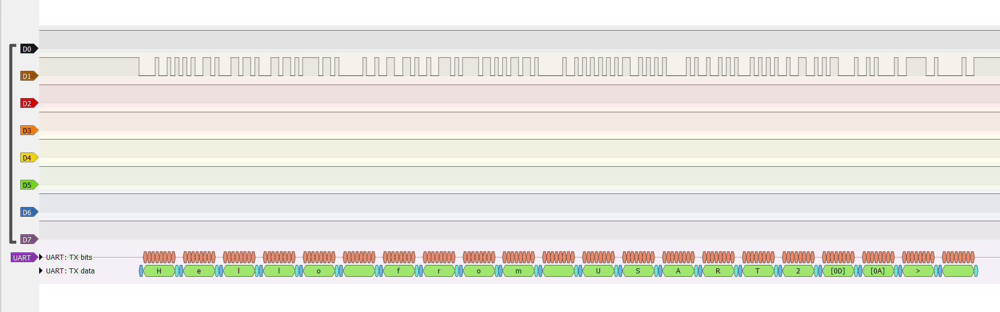
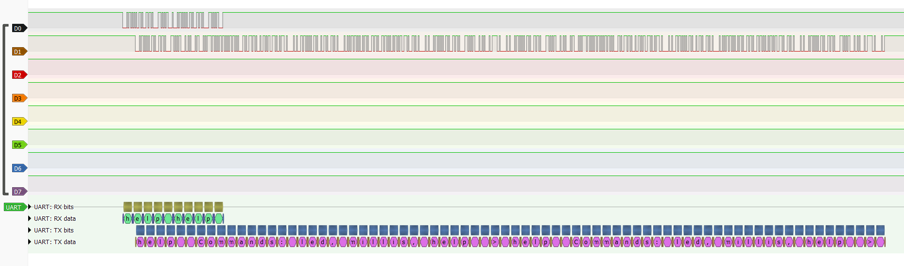
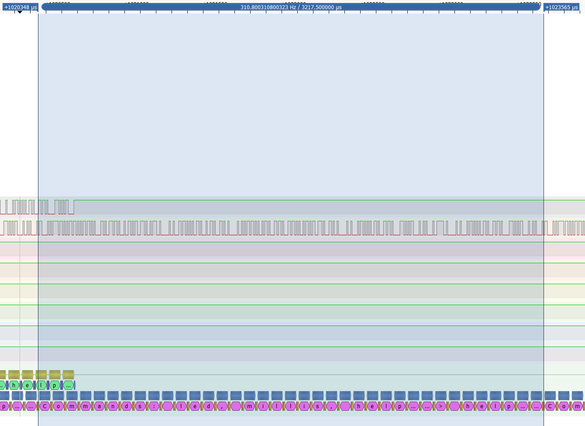
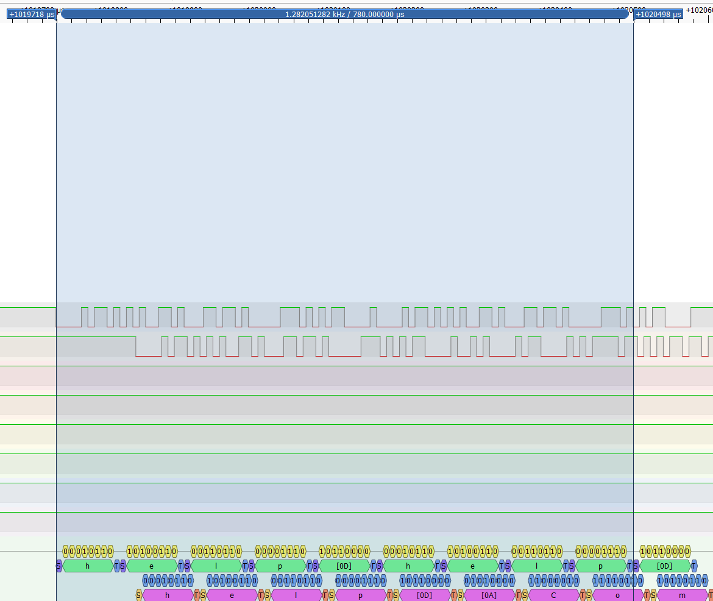
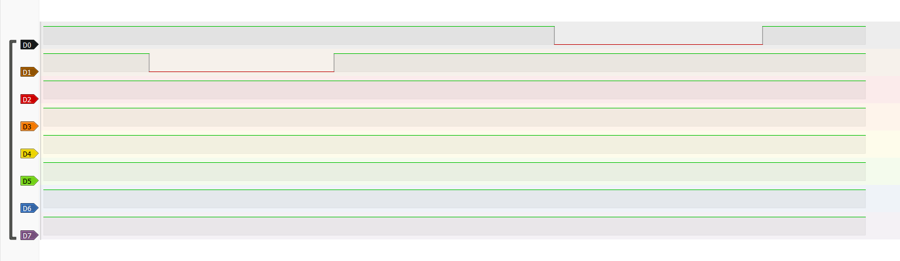

# Learning log

## 2026-10-16: Toolchain and const placement

### Experiment setup

Installed STM32CubeIDE for Visual Studio Code and created an empty CMake project for the STM32F411RE. It has ST's startup file and linker script, and no HAL.

### Experiment: what does `const` change for a table?

```c
static const uint8_t lookup_table[256] = { 1, 2, 3 };

volatile uint32_t table_index = 7;
volatile uint32_t table_value;

int main(void)
{
    table_value = lookup_table[table_index];

    for (;;) {
    }
}
```

The index is `volatile`, so the table is read at run time. The compiler or linker can drop a table nothing reads, and then both builds would show identical numbers.

Prediction:

| Build | Section | Flash | RAM |
| --- | --- | --- | --- |
| with `const` | `.rodata` | 256 B | 0 |
| without `const` | `.data` | 256 B | 256 B |

Without `const`, the initial values still need flash, because RAM is empty at power-on. Startup code copies them into RAM before `main` runs.

Result, from the linker's memory report:

| Build | RAM | FLASH |
| --- | --- | --- |
| with `const` | 1984 B | 1180 B |
| without `const` | 2240 B | 1180 B |
| difference | +256 B | 0 |

The result matches the prediction. Flash did not change because the 256 bytes only moved, from `.rodata` to the initial-value image of `.data`, and both live in flash.

`static` gives the table internal linkage: no other file can link to it. It does not change where the table lives or how big it is.

## 2026-10-16: Which pin drives LD2

Method: search the manuals for exact labels instead of reading them. The board manual (UM1724) says what is wired to what. The chip manual (RM0383) says what each register bit does and where each peripheral sits in memory.

- UM1724 Rev 17, section 7.6 "LEDs" (p. 24): LD2 connects to Arduino signal D13, which is PA5 or PB13 depending on the board.
- Table 16, "ARDUINO connectors on NUCLEO-F401RE and NUCLEO-F411RE" (p. 44): on this board, D13 is PA5.
- PA5 means port A, pin 5, so the LED is driven through the GPIOA peripheral.

## 2026-10-17: GPIOA clock and PA5 mode

### Step 1: turn on GPIOA's clock

Every peripheral starts with its clock off. Writes to an unclocked peripheral are ignored, with no error. So the first write turns on GPIOA's clock in RCC.

- RCC base: 0x4002 3800 (RM0383 Table 1, p. 38)
- RCC_AHB1ENR: offset 0x30; bit 0 is GPIOAEN (section 6.3.9, p. 118)
- Address: 0x40023800 + 0x30 = 0x40023830

```c
#define RCC_AHB1ENR          (*(volatile uint32_t *)0x40023830u)
#define RCC_AHB1ENR_GPIOAEN  (1u << 0)

RCC_AHB1ENR |= RCC_AHB1ENR_GPIOAEN;
(void)RCC_AHB1ENR;
```

`|=` is already a read-modify-write. OR with 1 forces bit 0 on. OR with 0 leaves the other 31 bits unchanged.

The second line reads the register back. After the enable write, the clock can take 2 AHB cycles to start (errata item "Delay after an RCC peripheral clock enabling": ES0299 section 2.2.7 for the sibling STM32F401; ES0287 is the F411's own errata sheet). If the next read of GPIOA_MODER landed too early, it could return 0, and the write-back would turn PA13 and PA14 into inputs and cut off the debugger. ST's HAL does the same read-back.

**Correction (2026-10-21):** the "could return 0" part isn't supported. With GPIOA's clock fully off, a debugger read of GPIOA_MODER returned 0xA8000000, its reset value, not 0 (see the 2026-10-21 entries). The errata asks for the delay but doesn't say what an early access returns, and reads from my own code haven't been tested. The read-back stays.

### Step 2: make PA5 an output

- GPIOA base: 0x4002 0000 (Table 1). MODER offset: 0x00 (Table 26, GPIO register map).
- Address: 0x40020000 + 0x00 = 0x40020000
- Each pin y has a 2-bit field at bits 2y+1:2y. For PA5, that is bits 11:10.
- Field values: 00 input (reset state), 01 general-purpose output, 10 alternate function, 11 analog.
- Port A's MODER resets to 0xA800 0000: PA13, PA14, and PA15 start in alternate function mode, and PA13 and PA14 carry the debugger. A plain `=` would cut the debugger off, so only PA5's two bits change: clear them, then OR in the new value.

```c
#define GPIOA_MODER        (*(volatile uint32_t *)0x40020000u)
#define GPIOA_MODER5_POS   10u
#define GPIOA_MODER5_MASK  (3u << GPIOA_MODER5_POS)
#define GPIO_MODE_OUTPUT   1u

GPIOA_MODER = (GPIOA_MODER & ~GPIOA_MODER5_MASK)
            | ((GPIO_MODE_OUTPUT << GPIOA_MODER5_POS) & GPIOA_MODER5_MASK);
```

AND with the inverted mask: 0 clears bits 11:10, and 1 keeps every other bit. OR with the shifted value: 1 sets a bit, and 0 keeps it.

### Mistakes and how they were caught

1. **Wrong bit number.** I said GPIOAEN was bit 1. It is bit 0. Bit numbers start at 0 on the right, and the "0:" and "1:" lines under a field are values, not positions. Bit 1 is GPIOBEN, so the LED would have stayed dark with no error.
2. **Wrong name.** My first draft named the RCC register `GPIOA`. Registers now use the manual's names, so anyone can search the manual and check the address.
3. **A number, not a register.** `#define GPIOA_MODER 0x40020000u` makes the name a plain number, so assigning to it does not compile: GCC reports "lvalue required as left operand of assignment." A register define has to dereference a volatile pointer.
4. **Macro without parentheses.** With `#define MASK 3u << 10`, `~MASK` expands to `(~3u) << 10`, which is 0xFFFFF000. That clears the fields for PA0 through PA5, not just PA5. At reset those fields are already 00, so the bug stays hidden until a pin from PA0 to PA4 is configured before this line runs.
5. **Masked before shifting.** `(value & MASK) << 10` gives 0, because the mask sits at bit 10 and the value at bit 0. PA5 would have stayed an input. Shifting the value into position first, then masking, fixes it.

### Next

- Find GPIOA_ODR's offset and write the statement that toggles PA5.
- Add a delay loop.
- Flash the board, and read MODER back in the debugger to confirm PA5's mode.

## 2026-10-17: Toggle, delay, and the first blink

### Step 3: toggle PA5

- GPIOA_ODR: offset 0x14 (Table 26). Address: 0x40020000 + 0x14 = 0x40020014. It resets to 0, so every pin starts low.
- Bit y sets pin y's output level: 1 is high, 0 is low. PA5 is bit 5, so the mask is 1u << 5 = 0x20.

```c
#define GPIOA_ODR       (*(volatile uint32_t *)0x40020014u)
#define GPIOA_ODR_ODR5  (1u << 5)

GPIOA_ODR ^= GPIOA_ODR_ODR5;
```

XOR gives 1 only where the two bits differ. So XOR with 1 flips a bit, and XOR with 0 keeps it. The mask has a 1 only at bit 5, so each pass flips PA5 and leaves the other 31 bits alone.

```text
operator   mask bit 0   mask bit 1
OR  |      keep         force 1      set
AND &      force 0      keep         clear
XOR ^      keep         flip         toggle
```

### Step 4: a busy-wait delay

Prediction without a delay: one pass of the loop takes on the order of 10 cycles, so at 16 MHz PA5 flips about 1.6 million times per second. The eye can't follow on and off faster than roughly 50 to 100 times per second, so LD2 would look steadily lit and dimmer, not blinking.

The delay wastes time by counting. For 0.5 s on and 0.5 s off:

- cycles = rate × time = 16,000,000 × 0.5 = 8,000,000 cycles
- passes = cycles ÷ cycles per pass = 8,000,000 ÷ 10 = 800,000 passes

```c
#define SYSCLK_HZ               16000000u   /* internal oscillator (HSI) after reset */
#define CYCLES_PER_DELAY_PASS   10u         /* estimate; measure on hardware */
#define HALF_SECOND_PASSES      (SYSCLK_HZ / 2u / CYCLES_PER_DELAY_PASS)

for (;;) {
    GPIOA_ODR ^= GPIOA_ODR_ODR5;

    for (volatile uint32_t pass = 0; pass < HALF_SECOND_PASSES; pass++) {
    }
}
```

The counter is volatile so that every pass has to happen. Without it, the loop has no observable effect, and an optimized build may shrink it or delete it. Debug builds (-O0) don't optimize, so they hide this bug.

### Result

Debug build, flashed through the on-board ST-LINK: LD2 blinks. A phone stopwatch counted 10 blinks in 10 seconds, so the 10-cycles-per-pass estimate held, within what counting by eye can resolve.

**Correction (2026-10-18):** a 60-second video of the same build counted 51 to 52 blinks, so a pass takes about 11.6 cycles at -O0, not 10. A 10-second count can't resolve that difference. See the 2026-10-18 entry.

### Mistakes and confusions

1. **Counting 1s instead of positions.** "Bit 5" is the sixth position from the right, counting from 0, whatever value it holds. My count landed right only because PA5 happened to be high.
2. **Cycles vs passes.** I said half a second was 400,000 cycles and 400,000 passes. It's 8,000,000 cycles, and passes = cycles ÷ cycles per pass, so the two numbers can't match.
3. **Two meanings of "cycle".** A clock cycle is one tick at 16 MHz. One on plus one off is a blink, or a period. The 8,000,000 clock cycles of one wait are all "on" or all "off", not split between them.

Also learned: a comma can't go inside a C number. `3,200,000u` is three numbers, and in a loop condition it compiles silently and the loop runs zero times.

### Next steps: first blink

- Remove volatile in an optimized build and watch the blink speed up or vanish.
- Read GPIOA_MODER back in the debugger to confirm PA5's mode.

## 2026-10-18: What -O2 does to the delay loop

### Setup

The optimization level is how hard the compiler works at making the translated code faster. -O0, used by the Debug build, turns every line of C into its own instructions, in order. -O2 may shorten, merge, reorder, or skip work, as long as the program's result stays the same.

The compiler only has to keep the program's result, which the C standard calls observable behavior. Every read and write of a `volatile` object counts as part of the result. How long the code takes does not, and a busy-wait loop's only product is time.

For this demo only, the first line of main.c was:

```c
#pragma GCC optimize("O2")
```

It tells GCC to compile every function below it in main.c at -O2, so the Debug build ran optimized code without touching CMake. It came out afterward.

One change per step. I predicted before every flash and counted blinks from phone video. The instruction counts come from GCC 13.2 and 14.2 builds of the same code, whose delay loops were identical. My toolchain is GCC 14.3.1, so only the blink counts are my measurements.

### Results

Steps 1 to 4 ran with the pragma.

| Step | Delay | Counter | Predicted | Result |
| --- | --- | --- | --- | --- |
| Baseline, -O0 | inline | `volatile` | | 51 to 52 blinks per minute, about 11.6 cycles per pass |
| 1 | inline | `volatile` | slightly faster: 7 instructions per pass become 6 | about 60 blinks per minute, 10 cycles per pass |
| 2 | inline | not `volatile` | faster, about 150 per minute | 34 blinks in 10 s (about 204 per minute), about 3 cycles per pass |
| 3 | in its own function | not `volatile` | same rate as step 2 | no visible blink, a steady light |
| 4 | in its own function | `volatile` | about 60 per minute | 20 blinks in 20 s |

From blinks to cycles per pass: one blink is two waits, one wait is 800,000 passes, and the clock runs 16,000,000 cycles per second. At 51.5 blinks per minute, a wait takes 60 ÷ 103 ≈ 0.58 s, which is about 9.3 million cycles, or 11.6 per pass.

What each step showed:

- **Step 1.** `volatile` forces 2 reads and 1 write of `pass` on every pass: one read to compare, then a read and a write for the increment. All 800,000 passes stay. -O2 trims only what isn't protected: at -O0 every pass reloads the limit from flash, and at -O2 the limit stays in a register. 60 ÷ 51.5 ≈ 1.17, and 7 ÷ 6 ≈ 1.17.
- **Step 2.** Without `volatile`, none of those accesses has to happen. The compiler kept the loop but replaced `pass` with a register counting down: 2 instructions per pass and no memory access. The "half second" became about 0.15 s.
- **Step 3.** The same loop moved into `static void delay_half_second(void)`, and the compiler deleted it. `main` now toggles LD2 millions of times per second, which looks like a steady light. Stepping through `main` in the debugger alternates between the `for (;;)` line and the XOR line and never stops on the `delay_half_second()` line, because that line has no instructions left.
- **Step 4.** `volatile` back inside the function brings the blink back at the step 1 rate.

### Takeaways

- A busy-wait counter must be `volatile`. Without it, the compiler may shrink the delay or delete it. Here a harmless-looking refactor flipped it from shrunk to deleted. A Release build or a compiler upgrade can do the same.
- The C rules say the compiler *may* delete the loop. Whether it does is the compiler's choice: step 2 kept a deletable loop, and step 3 didn't.
- Even with `volatile`, busy-wait timing depends on the build: about 11.6 cycles per pass at -O0 and 10 at -O2, so `CYCLES_PER_DELAY_PASS` can't be right for both. A hardware timer (SysTick) fixes that.

Also learned: in optimized code, the debugger's highlighted line jumps around. Instructions from different lines get reordered and merged, and a line whose work was removed never gets highlighted.

### Mistakes and confusions

1. **Same result, same speed.** For step 1, I first predicted the same rate, because the result stays the same. Time isn't part of the result, and making code faster is -O2's job.
2. **Step 3 predicted from step 2.** I assumed the compiler would repeat step 2's countdown. It isn't bound to: C allowed deleting the loop both times.
3. **Units in the chain.** I wrote that 800,000 passes take 60 seconds. That's one half-second wait. Writing the chain one row at a time fixed it: cycles per wait, then seconds per wait, then two waits per blink.
4. **Half an answer, again.** "Too fast for the eye" isn't the whole picture. LD2 looks like a steady light, dimmer than fully on, because it's on only about half the time.

### Next steps: optimization

- Read GPIOA_MODER back in the debugger to confirm PA5's mode.
- Replace the busy-wait with SysTick, so the delay doesn't depend on the build.

## 2026-10-20: Reading GPIOA_MODER back in the debugger

### Setup

Debug build (-O0), no pragma. The "STM32Cube: Launch ST-Link GDB Server" configuration stops at `main`, and the peripheral register view shows GPIOA's MODER and its fields. Step Over (F10) runs one source line. The highlighted line is the next line to run: it hasn't run yet.

Reading a field is the mirror of writing one: shift right by the field's position, then AND with its width mask. OR can't pick a field out. For PA5: `(GPIOA_MODER >> GPIOA_MODER5_POS) & 3u`.

### Prediction, worked on paper

| Step | Value |
| --- | --- |
| GPIOA_MODER after reset | 0xA8000000 |
| AND with `~(3u << 10)`, which is 0xFFFFF3FF | 0xA8000000 (bits 11:10 were already 00) |
| OR with `1u << 10`, which is 0x00000400 | 0xA8000400 |
| PA5's field: `(0xA8000400 >> 10) & 3u` | 1, output |

### Results

| Point | Predicted | Read |
| --- | --- | --- |
| Stopped at `main`, RCC line next | 0xA8000000 | 0xA8000000 |
| RCC line and read-back done, setup line next | 0xA8000000 | 0xA8000000 |
| Setup line done | 0xA8000400 | 0xA8000400 |
| PA5's field (MODER5), setup line done | 01 (output) | 0b01 |

All four matched. The setup line changes only bits 11:10, PA5's mode, from 00 (input) to 01 (output). Bits 31:26 keep their reset value, so PA13, PA14 and PA15 stay in alternate function and the debugger stays connected.

### Open question

At the first point, GPIOA's clock should still be off. Several sources say an unclocked peripheral reads as 0, but the view showed the reset value. Two explanations fit: the chip answered the read without the clock, or the read failed and the view showed a stored reset value. Not yet explained.

**Answered (2026-10-21):** the chip answered the read without the clock. At the same stop, the Memory Inspector showed GPIOAEN at 0 and read GPIOA_MODER as 0xA8000000. See the 2026-10-21 entries.

### Mistakes and confusions

1. **Shifts written one place short.** I wrote `3u << 10` as 11 followed by nine zeros, which puts the field at bits 10:9. The setup line would then give 0xA8000200: PA5 stays an input, and PA4 becomes alternate function. `x << n` puts exactly n zeros to the right of x, because bit numbers start at 0.
2. **`~` written at 11 bits.** `~` flips all 32 bits: `~(3u << 10)` is 0xFFFFF3FF. As an 11-bit pattern, the AND would clear everything above bit 10, including the debugger pins.
3. **MODER 00 read as "off".** 00 is input mode. MODER holds the mode, and ODR holds the level, which only reaches the pin once MODER says output.

### Next steps: read-back

- At the first stop, check GPIOAEN in RCC_AHB1ENR and read 0x40020000 through the Memory Inspector, to settle the open question.
- Replace the busy-wait with SysTick, so the delay doesn't depend on the build.

## 2026-10-21: Reading GPIOA with its clock off

### Setup

The 2026-10-20 entry left a question open. At the first stop, GPIOA's clock should be off, yet the peripheral view showed GPIOA_MODER = 0xA8000000. Three explanations fit:

1. GPIOA's clock was already on at that stop.
2. The chip answers a read of GPIOA even with its clock off.
3. The view didn't show a live read. It knows each register's reset value from the chip's description file, so a failed read could leave that stored value on screen.

The Memory Inspector separates them. It reads raw memory at an address and stores nothing, so whatever it shows came from the chip. It opens during a debug session from the Command Palette: "Memory: Show Memory Inspector". In its settings, I set MAUs per Group to 4, so each group shows one 32-bit register. The default of 1 shows single bytes.

- RCC_AHB1ENR (0x40023830) tests explanation 1. RCC has no clock gate of its own, so it always answers.
- GPIOA_MODER (0x40020000) then separates 2 from 3.

Debug build (-O0), same main.c as 2026-10-20. I wrote the predictions down before launching.

### Results

| Reading | Stop | Tool | Predicted | Read |
| --- | --- | --- | --- | --- |
| GPIOA_MODER | `main`, RCC line next | Peripheral view | 0xA8000000 | 0xA8000000 |
| RCC_AHB1ENR (0x40023830) | same | Memory Inspector | 0x00000000 | 0x00000000 |
| GPIOA_MODER (0x40020000) | same | Memory Inspector | 0xA8000000 | 0xA8000000 |
| GPIOA_MODER (0x40020000) | setup line next | Memory Inspector | 0xA8000000 | 0xA8000000 |

- GPIOAEN, bit 0 of RCC_AHB1ENR, was 0 at the first stop, so GPIOA's clock was off. Explanation 1 is out.
- At the same stop, the Memory Inspector read GPIOA_MODER as 0xA8000000. A live read returned the register's value with the clock off: explanation 2.
- The peripheral view showed the same value, so explanation 3 isn't needed.
- The last row is the control. By then the clock is on, so that read is live under every explanation.

On this board, a debugger read of GPIOA_MODER works with GPIOA's clock off. Not tested: reads from my own code, writes with the clock off, and other registers and peripherals.

One gap remained: a 0 from RCC_AHB1ENR can't tell a real read from a failed one. The next entry closes it.

### Mistakes and confusions

1. **A stored value in the wrong tool.** My first prediction gave "the pre-filled value from the document" as the reason for a Memory Inspector reading. Only the peripheral view might show a stored value. The Memory Inspector stores nothing.
2. **Prediction and explanation didn't match.** In my first set, I predicted 0xA8000000 for GPIOA_MODER but picked explanation 3. With GPIOAEN at 0, a live 0xA8000000 is explanation 2. I redid the set before launching.
3. **One register for the whole peripheral.** I asked whether RCC is always 0 after reset. RCC_AHB1ENR resets to 0, but each register has its own reset value: RCC_CR starts with its oscillator switched on. And not every reset touches the peripherals. A debugger can reset only the CPU core, which leaves them as they were.
4. **The chip isn't the board.** The chip is the STM32F411RE. The NUCLEO-F411RE is the board around it: the chip, LD2, the buttons, the headers, and the ST-LINK, which has its own microcontroller and talks to the chip over SWD on PA13 and PA14.

## 2026-10-21: Checking the Memory Inspector against known values

### Setup

The previous entry leaned on one reading I couldn't fully trust. RCC_AHB1ENR read 0x00000000 at the first stop, but a failed read, or a display that fills in zeros, would also show 0. A reading only counts as evidence if it could have come out differently, so this run read values that can't be 0.

It also tested a second question. Every Memory Inspector reading came back as a row of four 4-byte groups, even when I asked for 4 bytes. The first group is the register at the address I typed, and each next group starts 4 bytes further on. Were the other three groups real reads?

- RCC_CR (0x40023800): RM0383 section 6.3.1 lists its reset value as 0x0000 XX81, where XX varies by chip. A real read can't be 0.
- RCC_AHB1ENR (0x40023830), after the RCC line sets bit 0.
- GPIOA's first four registers, with Length 16: GPIOA_MODER, GPIOA_OTYPER, GPIOA_OSPEEDR, and GPIOA_PUPDR. For port A, RM0383 lists 0xA800 0000, 0x0000 0000, 0x0C00 0000, and 0x6400 0000. The speed and pull values are nonzero because of the debug pins.

Debug build (-O0), same main.c, Memory Inspector at 4 bytes per group. I wrote the predictions down before launching.

### Prediction: RCC_CR isn't its printed reset value

RM0383 lists a register's value at the instant of reset, and some bits change on their own after that. HSIRDY (bit 1 of RCC_CR) is read-only, and hardware sets it once HSI, the internal 16 MHz oscillator, runs steadily. The chip runs on HSI, so by the time it reaches `main`, HSIRDY is 1.

```text
bit          3   2   1 (HSIRDY)   0 (HSION)
at reset     0   0   0            1           = 1
at main      0   0   1            1           = 3
```

So RCC_CR should read 0x0000XX83, not ...81.

### Results

| Reading | Stop | Address, Length | Predicted | Read |
| --- | --- | --- | --- | --- |
| RCC_CR | `main`, RCC line next | 0x40023800, 4 | 0x0000XX83 | 0x00006983 |
| RCC_AHB1ENR | setup line next | 0x40023830, 4 | 0x00000001 | 0x00000001 |
| GPIOA, first four registers | setup line next | 0x40020000, 16 | a8000000 00000000 0c000000 64000000 | a8000000 00000000 0c000000 64000000 |

All three matched.

- RCC_CR: XX is HSICAL, a calibration value set at the factory. Mine is 0x69.
- RCC answers real reads at the first stop, and reads at 0x40023830 show real values. So the previous entry's 0x00000000 was a real read, and GPIOA's clock really was off.
- GPIOA's four registers read their RM0383 reset values. On the previous run, with Length 4, the same row showed zeros where GPIOA_OSPEEDR and GPIOA_PUPDR read 0x0C000000 and 0x64000000 here. So the Memory Inspector fills a row past the requested Length with zeros that weren't read. Length counts bytes, and only the groups inside it count.

Also learned: likely vs known. Something I reasoned out from the manual or from other readings is only likely. A reading that could have come out differently makes it known. Before this run, "those zeros were filler" was likely; the Length 16 read made it known.

### Mistakes and confusions

1. **The printed reset value as the live value.** My first prediction for RCC_CR was 0x0000XX81, the value as printed. A reset value is a snapshot at the instant of reset, and read-only status bits can change before any code runs.
2. **The first group isn't offset 0.** I read "the first group" as the peripheral's first register. It's the register at the address I typed. At 0x40023830, group 1 is RCC_AHB1ENR, not RCC_CR.
3. **Wrong stop, again.** For RCC_AHB1ENR at the second stop, I first gave the first stop's value. By then, the RCC line has set GPIOAEN.
4. **A match that proves nothing.** I thought a 00000000 group at GPIOA_OTYPER might show a real read, since its reset value is 0. It can't: a real read and filler both show 0.
5. **One reading vouching for another.** I said the second group of the RCC_CR row was a real read because the first group was. Each group answers for itself. That group is RCC_PLLCFGR, which resets to 0x2400 3010, and it showed 00000000, outside the 4 bytes I asked for. So it was almost certainly filler. A direct read of 0x40023804 would confirm it. **Confirmed (2026-10-22):** a direct read returned 0x24003010, so it was filler. See the 2026-10-22 entry on RCC_PLLCFGR.
6. **Address vs value.** I said RCC_CR's address changed. Its address is fixed at 0x40023800; its value changed.

### Next steps: Memory Inspector

- Read RCC_PLLCFGR (0x40023804) directly, to confirm the zero in the RCC_CR row was filler.
- Byte order: read GPIOA_MODER one byte at a time in the Memory Inspector, and see how four bytes in memory make one 32-bit value.
- Replace the busy-wait with SysTick, so the delay doesn't depend on the build.

## 2026-10-22: Byte order in memory

### Setup

A 32-bit register is four bytes, and each byte has its own address: the register's address, then +1, +2, and +3. That's why the next register starts 4 bytes further on. The bytes are numbered 0 to 3 from the bits 7:0 end: byte 0 holds bits 7:0, and byte 3 holds bits 31:24. A byte's address is the register's address plus its number.

Endianness is the rule for which byte goes at the lowest address. Little-endian puts byte 0 there; big-endian puts byte 3 there.

Two Memory Inspector settings decide what a row shows:

- MAUs per Group: at 1, each byte is its own group of 2 hex digits, lowest address on the left. At 4, four bytes make one group of 8 digits.
- Group Endianness: how a 4-byte group is turned into one number. It changes the display, never memory.

Debug build (-O0), same main.c, Length 4 throughout. RCC_CR is the calibration: its value, 0x00006983, is known from the 2026-10-21 entry, and its low bytes, 83 and 69, differ, so its row shows the order. I wrote the GPIOA_MODER predictions down before launching.

### Prediction: from a value to its bytes in memory

Two steps: split the value by bits, then place each byte by address.

```text
GPIOA_MODER after the setup line = 0xA8000400

step 1, split by bits:
bits      31:24        23:16        15:8         7:0
byte      A8           00           04           00

step 2, place by address (bits 7:0 at the lowest):
address   0x40020000   0x40020001   0x40020002   0x40020003
byte      00           04           00           A8
```

The bytes move, but the two digits inside each byte don't: A8 stays A8.

### Results

| Register | Stop | Display | Predicted | Read |
| --- | --- | --- | --- | --- |
| RCC_CR (0x40023800) | `main`, RCC line next | 1 byte per group | 83 69 00 00 | 83 69 00 00 |
| GPIOA_MODER (0x40020000) | setup line next | 1 byte per group | 00 00 00 A8 | 00 00 00 a8 |
| GPIOA_MODER | setup line done | 1 byte per group | 00 04 00 A8 | 00 04 00 a8 |
| GPIOA_MODER | setup line done | 4 bytes per group, Little Endian | a8000400 | a8000400 |
| GPIOA_MODER | setup line done | 4 bytes per group, Big Endian | 000400A8 | 000400a8 |

All five matched.

- RCC_CR's row starts with 83, the byte holding bits 7:0. So that byte sits at the lowest address: this chip stores words little-endian.
- The setup line changed one byte, at 0x40020001, from 00 to 04. That byte holds bits 15:8, which include PA5's mode field, bits 11:10.
- Group Endianness changes only how the tool turns four bytes into one number. Little Endian writes them from the highest address down, which gives the register's value. Big Endian writes them from the lowest address up, which keeps memory order.

```text
memory, lowest address first   00 04 00 a8
Little Endian                  a8000400   highest address first: the register's value
Big Endian                     000400a8   lowest address first: memory order
```

### The display didn't always follow a settings change

Changing Group Endianness didn't redraw the row by itself, twice. What I did next, and whether the row then showed the new setting:

| Next action | Row redrawn |
| --- | --- |
| Typed the address again | Yes twice, no once |
| Clicked Go | No, once |
| Clicked "Load 128 more bytes above", then Go | Yes, twice |
| Changed MAUs per Group to 1 and back to 4 | Yes, once |

Each MAUs per Group change redrew the row on its own, using the current Group Endianness. Stepping to a new stop where the bytes had changed also refreshed the row. So after changing Group Endianness, I force a redraw with one of the last two actions, then check the row's shape and value against my prediction.

The Load button also reads the 128 bytes at the addresses just before the one I typed. Some registers change when they're read, such as a UART's data register, so I only use it where nothing in that range does.

### Mistakes and confusions

1. **Number order written as the row.** I first wrote GPIOA_MODER's row as A8 00 00 00: the value split into bytes, biggest first, but not placed by address. That's step 1 of 2.
2. **A hex digit taken for a byte.** For the byte holding PA5's field, I gave bits 11:8. That's one hex digit, 4 bits. The byte is two digits, bits 15:8.
3. **No method for a byte's address.** I counted bytes from the wrong end and couldn't find a byte's address. Bytes count from the bits 7:0 end, and a byte's address is the register's address plus its number.
4. **The display setting run as storing.** I predicted the Big Endian group as A8 00 04 00, the value's own byte order. Storing goes from a value into memory. The setting goes the other way: it starts from the bytes in memory and turns them back into a number.

### Next steps: byte order

- Read RCC_PLLCFGR (0x40023804) directly, one byte per group and as one group under each setting. Its four bytes all differ, and a direct read settles whether the zero in the 2026-10-21 RCC_CR row was filler.
- Replace the busy-wait with SysTick, so the delay doesn't depend on the build.

## 2026-10-22: Reading RCC_PLLCFGR directly

### Setup

In the 2026-10-21 RCC_CR row, read with Length 4 at 0x40023800, the second group showed 00000000. That group sits at 0x40023804, which is RCC_PLLCFGR. RM0383 lists its reset value as 0x2400 3010, and main.c never writes it, so it should hold that value at every stop. The zero was either filler or a real read that disagrees with the manual. Until something read 0x40023804 directly, "filler" was only likely.

A direct read also makes a fresh byte-order test. The four bytes of 0x24003010 all differ, so each display setting shows something different.

Debug build (-O0), same main.c, Length 4. I wrote the predictions down before reading.

### Prediction

```text
RCC_PLLCFGR = 0x24003010

step 1, split by bits:
bits      31:24        23:16        15:8         7:0
byte      24           00           30           10

step 2, place by address (bits 7:0 at the lowest):
address   0x40023804   0x40023805   0x40023806   0x40023807
byte      10           30           00           24
```

Little Endian writes the four bytes from the highest address down, so it should show 24003010, the register's value. Big Endian writes them from the lowest address up, so it should show 10300024.

### Results

| Display | Predicted | Read |
| --- | --- | --- |
| 4 bytes per group, Little Endian | 24003010 | 24003010 |
| 4 bytes per group, Big Endian | 10300024 | 10300024 |
| 1 byte per group | 10 30 00 24 | 10 30 00 24 |

All three matched. After I set the gear back, Little Endian read 24003010 again.

- A real read at 0x40023804 returns 0x24003010, not 0. So the 00000000 in the 2026-10-21 row was filler, and that's now known. This read could have come out 00000000, and it didn't.
- RCC_PLLCFGR sits in memory as 10 30 00 24, with the byte holding bits 7:0 at the lowest address, like RCC_CR and GPIOA_MODER.
- Little Endian gave the register's value, and Big Endian gave memory order, as with GPIOA_MODER.

### Mistakes and confusions

1. **Likely called known.** Before the read, I called the filler claim known, because the Memory Inspector had shown filler before. That was at GPIOA's addresses, in a different row. One reading can't vouch for another.
2. **Group 2's address.** I didn't see how a read at 0x40023800 involved RCC_PLLCFGR at 0x40023804. At 4 bytes per group, group 2 starts 4 bytes after the address I typed.
3. **The display setting run as storing, again.** I first predicted Little Endian as 10300024 and Big Endian as 24003010. My Big Endian rule, least significant byte at the highest address, was right, but I applied it to the value instead of to the bytes in memory. Applied to memory, the byte at the highest address, 24, goes last: 10300024.

### Next steps: direct read

- Replace the busy-wait with SysTick, so the delay doesn't depend on the build.

## 2026-10-25: SysTick delay

### Setup

The busy-wait's timing depended on the build: about 11.6 cycles per pass at -O0 and 10 at -O2, so `CYCLES_PER_DELAY_PASS` couldn't be right for both (2026-10-18). SysTick replaces it. SysTick is a 24-bit timer that counts down, built into the Cortex-M4 core. It isn't an STM32 peripheral, so it needs no RCC clock enable. It counts clock cycles in hardware, so the build can't change its period.

PM0214, ST's Cortex-M4 programming manual, documents SysTick in section 4.5. The addresses and bit positions below match Arm's CMSIS header `core_cm4.h`.

| Register | Address | What it holds |
| --- | --- | --- |
| STK_CTRL | 0xE000E010 | The switches. ENABLE (bit 0) turns counting on, TICKINT (bit 1) runs the handler each time the count reaches 0, and CLKSOURCE (bit 2) selects the processor clock, 16 MHz after reset |
| STK_LOAD | 0xE000E014 | RELOAD, in bits 23:0: the number each countdown starts from |
| STK_VAL | 0xE000E018 | The current count. Writing any value clears it |

- The count shows RELOAD, RELOAD - 1, and so on down to 0, one number per cycle, so one period is RELOAD + 1 cycles. A 1 ms period at 16 MHz is 16,000 cycles, so RELOAD is 15,999. RELOAD has 24 bits, so its largest value is 0x00FFFFFF.
- Setup is three writes, in order: STK_LOAD; then STK_VAL = 0, so the first countdown starts from RELOAD; then STK_CTRL with all three switches on. STK_CTRL goes last because it starts everything.
- Each time the count reaches 0, the CPU pauses `main`, reads entry 15 of the vector table, runs `SysTick_Handler`, and then resumes `main` where it stopped. The startup file from ST declares a weak `SysTick_Handler` that points to `Default_Handler`, an infinite loop. A function with exactly that name replaces it.
- The handler adds 1 to `elapsed_ms`, so it counts milliseconds since setup. `static` keeps other files from changing it. `volatile` makes `main` re-read it: `main` never calls the handler, so without `volatile` the compiler sees no write and can reuse its first read. Other files read the count through `millis()`.
- `delay_ms()` saves the start time and waits while `millis() - start < ms`. Unsigned subtraction wraps modulo 2^32, like the counter, so the difference stays right when the counter rolls over, after about 49.7 days. Comparing `millis() < start + ms` would break near the wrap: `start + ms` can wrap to a small number and end the wait at once.

```c
#define STK_CTRL             (*(volatile uint32_t *)0xE000E010u)
#define STK_CTRL_ENABLE      (1u << 0)
#define STK_CTRL_TICKINT     (1u << 1)
#define STK_CTRL_CLKSOURCE   (1u << 2)
#define STK_LOAD             (*(volatile uint32_t *)0xE000E014u)
#define STK_VAL              (*(volatile uint32_t *)0xE000E018u)

#define SYSCLK_HZ               16000000u            /* internal oscillator (HSI) after reset */
#define SYSTICK_PERIOD_CYCLES   (SYSCLK_HZ / 1000u)  /* 1 ms */
#define BLINK_HALF_PERIOD_MS    500u

static volatile uint32_t elapsed_ms;

void SysTick_Handler(void)
{
    elapsed_ms++;
}

uint32_t millis(void)
{
    return elapsed_ms;
}

static void systick_start_1ms(void)
{
    STK_LOAD = SYSTICK_PERIOD_CYCLES - 1u;
    STK_VAL = 0u;
    STK_CTRL = STK_CTRL_ENABLE | STK_CTRL_TICKINT | STK_CTRL_CLKSOURCE;
}

static void delay_ms(uint32_t ms)
{
    uint32_t start = millis();
    while ((millis() - start) < ms) {
    }
}
```

In `main`, `systick_start_1ms()` runs after the MODER line, and the loop calls `delay_ms(BLINK_HALF_PERIOD_MS)` where the busy-wait used to be.

Debug build (-O0) unless noted. The pragma build used `#pragma GCC optimize("O2")` as the first line of main.c, as on 2026-10-18, and it came out afterward. I wrote the predictions down before each flash.

### Results

| Build | Predicted | Result |
| --- | --- | --- |
| Debug (-O0) | 60 blinks per minute | 60 blinks per minute |
| `#pragma GCC optimize("O2")` | 60 blinks per minute | 60 blinks per minute |
| Pragma, with `volatile` deleted from `elapsed_ms` | Steady light; `elapsed_ms` unchanged between two pauses | Steady light; `elapsed_ms` read 3281, then 5156; paused, the CPU was in the `while` loop of `delay_ms` |

- The busy-wait gave 51 to 52 blinks per minute at -O0 and about 60 at -O2 (2026-10-18). SysTick gave 60 in both builds.
- In the third run, the handler kept counting: 1,875 more ticks between the two pauses. `main` never saw them. Without `volatile`, the compiler can assume the counter doesn't change during the wait, so `millis() - start` stays 0 and the wait never ends. LD2 stayed on because the first XOR ran before the first wait. `volatile` went back in afterward.

### Mistakes and confusions

1. **RELOAD kept fixed.** For a 1 ms period, I first kept STK_LOAD at 3 and worked out how many 4-cycle periods fit in 1 ms. RELOAD is the setting I choose so that one period lasts the whole 16,000 cycles.
2. **Off by one.** Then I put 16,000 in STK_LOAD. The count runs from 16,000 down to 0, which is 16,001 numbers, so every period would run one cycle long. The rule is RELOAD = cycles - 1.
3. **volatile explained by its definition.** I said `volatile` "guarantees each read/write occurs." That's what it does, not why `elapsed_ms` needs it. The reason is that the handler changes it and `main` never calls the handler.
4. **Keywords.** I wrote `volatile static`, but C calls a storage-class keyword anywhere but first obsolescent, so it's `static volatile`. I also put `static` on `millis()`, which would have made the read function private to main.c.
5. **The skipped-write model.** For a flag set in a handler, I said the write "got skipped." The handler is kept, and its write lands in memory; what the optimizer drops is `main`'s re-reads. My prediction for the third run still assumed the counter wouldn't change, and the board showed it climbing.

### Next steps: SysTick

- Drive LD2 through GPIOA_BSRR (offset 0x18), which sets or resets a pin in one write, so an interrupt can't land inside a read-modify-write.

## 2026-10-28: Where variables live

### Setup

The compiler sorts code and variables into sections, and the linker script places each section in flash or in RAM. Flash keeps its contents with the power off, but my code can't change it with an ordinary store. RAM can be written in one instruction, but at power-up it holds nothing I can count on.

| Section or region | What goes there | Where it lives |
| --- | --- | --- |
| `.text` | Code | Flash |
| `.rodata` | `const` data and string literals | Flash |
| `.data` | Globals and statics that start at a nonzero value | RAM, with the starting values kept in flash |
| `.bss` | Globals and statics that start at 0, with no initializer or `= 0` | RAM only |
| Stack | Locals, return addresses, saved registers | RAM, from the top down |
| Heap | Blocks from `malloc` | RAM, from the end of `.bss` up |

- Before `main`, `Reset_Handler` in the startup file (`Src/startup_stm32f411xx.S`, from ST) runs two loops. `CopyDataInit` copies `.data`'s starting values from flash into RAM word by word, so flash has to keep every one of them, zeros included. `FillZerobss` writes zeros over `.bss` and needs only its start and end addresses, so `.bss` takes no flash.
- At reset, the CPU loads the stack pointer from entry 0 of the vector table: `_estack`, which the linker script (`stm32f411xe_flash.ld`) sets to the end of RAM, 0x20020000. Each function call moves the stack pointer down to make room for a frame.
- `elapsed_ms` is `static volatile uint32_t` with no initializer, so it starts at 0 and goes in `.bss`. `start` in `delay_ms` is a local, so it's on the stack.

I read both addresses in the Debug build (-O0): a breakpoint on the `while` line in `delay_ms`, Continue, then `&elapsed_ms` and `&start` in the Watch panel, at the first stop. I wrote the predictions down first.

### Results

| Expression | Predicted | Read |
| --- | --- | --- |
| `&elapsed_ms` | Near the bottom of RAM (0x20000000), in `.bss` | 0x200001B8 |
| `&start` | On the stack | 0x2001FFEC |

- `elapsed_ms` sits 0x1B8 = 440 bytes above the start of RAM. It's main.c's only variable outside the stack, so the 440 bytes below it belong to other files: `syscall.c`, `sysmem.c`, or the libraries the build links. The build's map file would say which.
- `start` sits 20 bytes below the top of RAM, 0x20020000. In the -O0 code, `main` saves 8 bytes of registers, and `delay_ms` saves 8 more and reserves 16 for its locals, with `start` 12 bytes into those 16: 0x20020000 - 8 - 8 - 16 + 12 = 0x2001FFEC.
- Both values read 0: the breakpoint hit before SysTick's first tick.

### Mistakes and confusions

1. **What instead of why.** I said `.data` values are stored in flash and copied to RAM, and that `elapsed_ms` is zero-initialized. The why: these variables change, so they live in RAM, and RAM holds nothing at power-up, so the starting values are kept in flash. For `.bss`, the startup loop writes the zeros itself, so there's nothing to keep.
2. **Stack or heap.** I wasn't sure what decides it. The declaration does: a local without `static` goes on the stack, and only `malloc` puts anything on the heap. A pointer to a heap block is two things in two places: the pointer where it's declared, and the block on the heap.

### Next steps: memory layout

- Find what takes the 440 bytes below `elapsed_ms` in the build's map file, `build/Debug/stm32f411_bare_metal.map`.

## 2026-11-02: Measuring LD2 with a logic analyzer

### Setup

The program is the SysTick version from 2026-10-25, unchanged: the loop flips PA5, then `delay_ms(500)` waits for 500 ticks of 16,000 HSI cycles each. This time I measured PA5 with a logic analyzer instead of counting blinks.

- **Analyzer:** a HiLetgo 24 MHz, 8-channel USB logic analyzer, read with sigrok PulseView. PulseView found it with its fx2lafw driver, listed as Saleae Logic. On Windows it needed the WinUSB driver, installed with Zadig.
- **Wiring, with both unplugged:** CH0 to D13 (PA5) on the right-hand Arduino header, and the analyzer's GND under CH7 to the GND socket just above D13. That header runs SCL/D15, SDA/D14, AVDD, GND, D13, so AVDD is one socket from the GND I needed. The analyzer has pins and the board's header has sockets, so each wire is a female-to-female jumper chained to a male-to-male one. Each device has its own USB cable to the PC.
- **Capture:** 100 kHz and 1 M samples, so 10 seconds with samples 0.01 ms apart. PulseView's Timing decoder on D0 labels the time between neighboring edges, so its labels alternate low time and high time, with a running average.

### Prediction

- High time 500 ms, low time 500 ms, and period 1000 ms (one rising edge to the next): each half of the loop waits 500 ticks.
- Not exactly 500.000 ms, but very close if the sample rate is high enough.

### Results

| Run | When | All 19 spans | High times only |
| --- | --- | --- | --- |
| 1 | Board already running | 500.28 to 500.68 ms, average 500.48 | 500.32 to 500.68 ms |
| 2 | Right after replugging both cables | 499.90 to 500.63 ms, average 500.31 | 499.98 to 500.54 ms |

- Every span landed within 0.14% of 500 ms, but none at 500.000. Sampling accounts for about 0.01 ms; the spans were up to 0.68 ms off.
- The code waited exactly 500 ticks every time, so what changed was the length of a tick, which the HSI's speed sets. In run 1 the HSI ran about 0.1% slow. In run 2 the spans slid from about 500.6 ms to about 500.0 ms within 10 seconds: the HSI sped up by about 0.1%, probably as the board warmed up after being replugged.
- The HSI is an RC oscillator inside the chip. ST trims each chip at the factory (HSICAL, 0x69 on this board) to about ±1% at 25 °C, so both runs are inside spec. Its speed also shifts with temperature and voltage.
- The analyzer times its samples from its own clock. The maker of its chip specifies a crystal within ±100 ppm: at most about 0.05 ms on 500 ms.

### Open question

The HSI is the likely cause, not a proven one. Running the chip from a crystal-based clock would settle it: on MB1136 C-02 and later boards, the ST-LINK supplies a fixed 8 MHz clock (UM1724, section 6.7.1). My prediction for that run: 500.00 ms within about 0.1 ms, with little spread.

### Mistakes and confusions

1. **The sample rate as the limit.** I predicted the readings would get very close to 500.000 ms if the sample rate were high enough. The sample rate only decides how precisely the analyzer sees when PA5 flips. The board's clock decides when it flips, and that's where the difference from 500 ms came from.
2. **A signal wire on an unpowered board.** With only the analyzer plugged in, connecting CH0 to D13 made LD2 glow faintly. With nothing attached, the analyzer's inputs read 1, probably through pull-up resistors inside it, and that fed a little current into PA5 and LD2. The signal wire goes on only while both are powered.

### Next steps: logic analyzer

- Capture the UART shell's frames with the same setup.
- Optional: the crystal-clock run above.

## 2026-11-04: USART2's clock and pins

### Setup

This starts a bare-metal UART command shell: the board will take commands typed in a terminal on the PC and answer them. The first step gives USART2 its clock and its pins.

USART2's pins, PA2 (TX) and PA3 (RX), go to the ST-LINK by default, not to the D0 and D1 sockets: solder bridges SB13 and SB14 are on (UM1724, section 6.8). The ST-LINK passes the bytes to the PC over the USB cable I flash with, as a virtual COM port. So nothing extra is wired.

| Register | Address | What I set |
| --- | --- | --- |
| RCC_APB1ENR | 0x40023840 | USART2EN (bit 17), USART2's clock. USART2 is on the APB1 bus, so its enable is here, not in RCC_AHB1ENR with GPIOA's |
| GPIOA_AFRL | 0x40020020 | 4 bits per pin pick which peripheral drives it: AF7, USART2, for PA2 (bits 11:8) and PA3 (bits 15:12) |
| GPIOA_MODER | 0x40020000 | 10, alternate function, for PA2 (bits 5:4) and PA3 (bits 7:6), so a peripheral drives the pins instead of ODR |

- These are the same steps as PA5's setup for LD2: turn on the clock, pick the peripheral, set the pin's mode. PA5 skipped the middle step, because in output mode my code drives the pin through ODR.
- The clock goes first, read back as for GPIOA. AFRL goes before MODER, so each pin is already routed to USART2 when MODER hands it over. ST's HAL uses the same order.
- Each AFRL and MODER statement is the MODER5 statement with new names: clear the pin's field, then OR in the new value.

```c
static void usart2_init(void)
{
    RCC_APB1ENR |= RCC_APB1ENR_USART2EN;
    (void)RCC_APB1ENR; // same errata wait as GPIOA's

    GPIOA_AFRL = (GPIOA_AFRL & ~GPIOA_AFRL2_MASK)
                | ((GPIO_AF_USART2 << GPIOA_AFRL2_POS) & GPIOA_AFRL2_MASK);
    GPIOA_AFRL = (GPIOA_AFRL & ~GPIOA_AFRL3_MASK)
                | ((GPIO_AF_USART2 << GPIOA_AFRL3_POS) & GPIOA_AFRL3_MASK);

    GPIOA_MODER = (GPIOA_MODER & ~GPIOA_MODER2_MASK)
                | ((GPIO_MODE_ALTERNATE << GPIOA_MODER2_POS) & GPIOA_MODER2_MASK);
    GPIOA_MODER = (GPIOA_MODER & ~GPIOA_MODER3_MASK)
                | ((GPIO_MODE_ALTERNATE << GPIOA_MODER3_POS) & GPIOA_MODER3_MASK);
}
```

In `main`, `usart2_init()` runs after the PA5 setup, and the blink loop is unchanged.

Debug build (-O0). I read the registers in the Memory Inspector at a breakpoint on `systick_start_1ms()`, after `usart2_init()` had run. I worked out the predictions before flashing.

### Results

| Check | Predicted | Read |
| --- | --- | --- |
| RCC_APB1ENR, first build | 0x00020000 | 0x00000000 |
| RCC_APB1ENR, after the fix | 0x00020000 | 0x00020000 |
| GPIOA_MODER | 0xA80004A0 | 0xA80004A0 |
| GPIOA_AFRL | 0x00007700 | 0x00007700 |

- **The first RCC_APB1ENR reading was 0.** MODER and AFRL were right, and `usart2_init` writes them right after the RCC line, so the function had run and the RCC write had gone somewhere else. The line read `RCC_AHB1ENR |= RCC_APB1ENR_USART2EN;`. It set bit 17 of RCC_AHB1ENR, which is reserved, and RCC_APB1ENR's define was missing. It compiled because a mask is only a number: nothing but its name ties `RCC_APB1ENR_USART2EN` to its register. GPIO setup needs only GPIOA's clock, so the pins came out right either way.
- In MODER, 0xA80004A0 puts 10 in both PA2's and PA3's fields and keeps PA5's 01. In AFRL, 0x00007700 is a 7 in PA3's field and a 7 in PA2's.

### Mistakes and confusions

1. **USART2's clock in the wrong register.** I wrote the enable as `RCC_AHB1ENR |= RCC_APB1ENR_USART2EN;` and never defined RCC_APB1ENR. My mask names start with their register's name, so in a `REG |= MASK` line the two prefixes should match. Here they didn't.
2. **AFRL's fields.** I put a single 7 at bits 7:4, where MODER keeps PA2 and PA3 together. AFRL gives each pin its own 4 bits, PA2 at 11:8 and PA3 at 15:12, so the value is 0x00007700.

### Next steps: UART shell

- Set USART2's baud rate, switch it on, and send a first line of text.

## 2026-11-05: A banner at 115200 baud

### Setup

A UART sends one bit at a time on one wire per direction, with no clock wire. The line rests at 1. Each byte goes out as a frame: a start bit (0), 8 data bits with the least significant first, and a stop bit (1). That's 8N1: 8 data bits, no parity, 1 stop bit, so each byte costs 10 bits on the wire. At 115200 baud, a bit lasts about 8.68 µs and a frame 86.8 µs, so the line carries at most 11,520 bytes a second.

With no clock wire, both ends have to be set to the same baud rate beforehand. The receiver starts timing at each start bit's falling edge and reads each bit near its middle, by its own clock. So clock error builds up only within one frame, and the two clocks only need to agree within a few percent: about ±3.3% in total for 8N1, by Analog Devices' estimate ("Determining Clock Accuracy Requirements for UART Communications").

| Register | Address | What it does |
| --- | --- | --- |
| USART2_BRR | 0x40004408 | Clock cycles per bit, rounded: 16,000,000 ÷ 115,200 = 138.9, so 139 (0x8B) |
| USART2_CR1 | 0x4000440C | UE (bit 13) turns USART2 on, TE (bit 3) the transmitter, and RE (bit 2) the receiver. Every other bit stays 0, which means 8N1 |
| USART2_SR | 0x40004400 | Flags: TXE (bit 7), DR can take the next byte; RXNE (bit 5), a byte has arrived |
| USART2_DR | 0x40004404 | The byte itself: a write sends it, and a read takes the byte that arrived |

- BRR holds cycles per bit, the way `SYSTICK_PERIOD_CYCLES` holds cycles per tick. Adding half the baud rate before dividing makes the integer division round to the nearest whole number, so it gives 139, not 138.
- With 139 cycles per bit, the real rate is 16,000,000 ÷ 139 = 115,108 baud, 0.08% slow. Adding the HSI's 0.1% from 2026-11-02 makes about 0.18%, far inside ±3.3%.
- BRR goes in before CR1, and CR1 goes last because it switches everything on, like STK_CTRL in the SysTick setup.
- Sending waits for TXE, then writes DR, and writing DR clears TXE. The wait is polling, an empty `while` loop like the one in `delay_ms`. The banner's 19 bytes take about 1.65 ms, and `main` does nothing else while it waits.
- PC side: PuTTY on Windows, connection type Serial, COM3, 115200 baud, 8 data bits, 1 stop bit, no parity, no flow control.

`usart2_init()` now ends by setting the speed and switching USART2 on:

```c
    USART2_BRR = USART2_CYCLES_PER_BIT;
    USART2_CR1 = USART2_CR1_RE | USART2_CR1_TE | USART2_CR1_UE;
```

The baud rate and the send functions:

```c
#define PCLK1_HZ SYSCLK_HZ
#define USART2_BAUD 115200u
#define USART2_CYCLES_PER_BIT ((PCLK1_HZ + (USART2_BAUD / 2u)) / USART2_BAUD)

static void usart2_write_byte(char byte)
{
    while ((USART2_SR & USART2_SR_TXE) == 0u) {
    }
    USART2_DR = (uint8_t)byte;
}

static void usart2_write_string(const char *str)
{
    while (*str != '\0') {
        usart2_write_byte(*str);
        str++;
    }
}
```

In `main`, `usart2_write_string("Hello from USART2\r\n")` runs right after `usart2_init()`, and the blink loop is unchanged.

Debug build (-O0). I read BRR and CR1 in the Memory Inspector at a breakpoint on the `usart2_write_string` line, then pressed Continue with PuTTY open. I worked out the predictions before flashing.

### Results

| Check | Predicted | Result |
| --- | --- | --- |
| USART2_BRR | 0x0000008B | 0x0000008B |
| USART2_CR1 | 0x0000200C | 0x0000200C |
| PuTTY at 115200 | The banner, once per start | "Hello from USART2", once per press of the reset button: 13 presses, 13 lines |
| PuTTY set to 9600 | Garbage | Garbage: a few letters among unprintable blocks |

- At 9600, the PC read each bit 12 times too slowly (115,200 ÷ 9,600), far past the few-percent tolerance, so it misread the bits.

### Mistakes and confusions

1. **Bytes per second.** I divided 115,200 by 8 and got 14,400. The start and stop bits are part of the 115,200, so each byte costs 10 bits: 11,520 bytes a second.
2. **Drift over a whole message.** I thought a 0.1% clock error would build up over a 100-byte message, and that the receiver would re-read a missed bit. The receiver restarts its timing at every start bit, so drift builds up only within one frame. UART never re-reads or resends a bit: a misread bit just makes a wrong byte.
3. **A fraction called a percent, and the wrong limit.** For BRR's error I wrote 0.0008%, but the fraction 0.0008 is 0.08%. Then I compared it with the HSI's 0.1% as if that were the limit. The two errors add, and the total is compared with the ±3.3% budget.

### Next steps: UART shell

- Read what I type, and echo it back.

## 2026-11-06: Echo

### Setup

- `usart2_read_byte` is `usart2_write_byte` turned around: it waits for RXNE, then reads DR, and reading DR clears RXNE.
- The loop echoes each byte. It answers `\r`, which the terminal sends for Enter, with `\r\n`.
- The blink loop is gone. While it sat in `delay_ms` for 500 ms, it wasn't checking RXNE, so a second byte arriving before the first was read would be lost.
- PC side: `screen /dev/ttyACM0 115200` in WSL. With the board attached to WSL, the ST-LINK's virtual COM port shows up there as `/dev/ttyACM0`. PuTTY on Windows could open COM3 only after I detached the board from WSL; screen doesn't need that.

```c
static char usart2_read_byte(void)
{
    while ((USART2_SR & USART2_SR_RXNE) == 0u) {
    }
    return (char)USART2_DR;
}
```

```c
    for (;;) {
        char typed = usart2_read_byte();
        if (typed == '\r') {
            usart2_write_string("\r\n");
        }
        else {
            usart2_write_byte(typed);
        }
    }
```

Debug build (-O0). I worked out the prediction before running the test.

### Results

| Check | Predicted | Result |
| --- | --- | --- |
| Pause in the debugger, type `a`, press Continue | `a` appears after Continue | `a` appeared after Continue |

- With the CPU halted, USART2 kept running. It received `a`, put it in DR, and set RXNE, and the byte waited there until the loop read it. ST's F411 header has debug bits that stop the timers, watchdogs, and RTC while the CPU is halted, and none for any USART.

### Mistakes and confusions

1. **"Everything pauses."** I predicted `a` would show up after Continue because everything was paused. The prediction was right but the reason wasn't: only the CPU pauses. If USART2 had paused too, `a` would never have arrived.

### Next steps: UART shell

- Add a line buffer and three commands: `led` to toggle LD2, `help` to list the commands, and `millis` to print the milliseconds since reset.
- Receive by interrupt into a ring buffer, so bytes aren't lost while the loop is busy.
- Capture the frames with the logic analyzer and PulseView's UART decoder.

## 2026-11-06: A line buffer and the first commands

### Setup

- The loop now collects typed letters in `line`, a 32-byte array, and `line_length` counts them. Enter ends the line, and `run_command` runs it as a command.
- Both are declared before the loop, so they keep their values from one byte to the next. They're locals in `main`, so they live on the stack, like `start` in the old `delay_ms`. `main` never returns, so they're never freed.
- A letter is stored only while there's room: `line_length < LINE_BUFFER_SIZE - 1u`. That keeps the last byte free for the `\0`. Without the check, the 33rd letter would land past the end of `line`, in whatever sits next to it on the stack: a buffer overflow. With `< LINE_BUFFER_SIZE` instead, 32 letters would fit, and Enter would write `\0` to `line[32]`, one byte past the end: an off-by-one.
- The compiler doesn't catch a missing check here, because the index is only known while the program runs. With the check removed, GCC 14.2 compiles it without a warning, even with -Wall -Wextra -Wpedantic at -O2. Like the wrong-register bug on 2026-11-04, a clean build doesn't mean it's right.
- Enter writes `\0` after the last letter. That makes `line` a C string: letters followed by the `\0` that `usart2_write_string` stops at. `run_command` compares it with each command name using `strcmp`, which returns 0 on a match. `strcmp` is declared in `<string.h>` and comes from the C library the build already links (`-lc`).
- `led` is the XOR line from the 2026-10-17 blink, now run once per command instead of in the blink loop. It then reads ODR back, so the reply reports LD2's new state.
- A terminal's Backspace key sends `\b` (8) or DEL (127), depending on its settings, so the code takes both. Backspace drops the last letter from `line` and sends `\b \b`: back up one, overwrite the letter with a space, back up again. On an empty line it does nothing, so it can't erase the prompt.

```c
#define LINE_BUFFER_SIZE 32u
#define ASCII_DEL 127u
```

```c
static void run_command(const char *line)
{
    if (strcmp(line, "led") == 0) {
        GPIOA_ODR ^= GPIOA_ODR_ODR5;
        if ((GPIOA_ODR & GPIOA_ODR_ODR5) != 0u) {
            usart2_write_string("LD2 ON\r\n");
        }
        else {
            usart2_write_string("LD2 OFF\r\n");
        }
    }
    else if (strcmp(line, "help") == 0) {
        usart2_write_string("Commands: led, help\r\n");
    }
    else if (line[0] != '\0') {
        usart2_write_string("Unknown command: ");
        usart2_write_string(line);
        usart2_write_string("\r\n");
    }
}
```

In `main`, the line buffer replaces the echo loop:

```c
    char line[LINE_BUFFER_SIZE];
    uint32_t line_length = 0u;

    usart2_write_string("> ");
    for (;;) {
        char typed = usart2_read_byte();
        if (typed == '\r') {
            usart2_write_string("\r\n");
            line[line_length] = '\0';
            run_command(line);
            line_length = 0u;
            usart2_write_string("> ");
        }
        else if ((typed == '\b') || (typed == ASCII_DEL)) {
            if (line_length > 0u) {
                line_length--;
                usart2_write_string("\b \b");
            }
        }
        else if (line_length < (LINE_BUFFER_SIZE - 1u)) {
            line[line_length] = typed;
            line_length++;
            usart2_write_byte(typed);
        }
    }
```

Debug build (-O0). I worked out the predictions before running the tests.

### Results

| Check | Predicted | Result |
| --- | --- | --- |
| `led`, right after a start | `LD2 ON` | `LD2 ON`, and LD2 lit |
| More than 31 letters, no Enter | Only the first 31 appear | Only the first 31 appeared |
| Then Enter | `Unknown command:` and the 31 letters | `Unknown command:` and the 31 letters |

- The first `led` said ON because ODR resets to 0, so LD2 starts off and the first XOR turns it on.
- The reply stopped at letter 31 because Enter wrote `\0` to `line[31]`, the array's last byte, and `usart2_write_string` stops at `\0`. The letters after the 31st were read from DR and stored nowhere, so nothing could bring them back.
- The rest of the run: `help` printed `Commands: led, help`. A second `led` printed `LD2 OFF`, and LD2 went dark. `ld2 on` came back as `Unknown command: ld2 on`, because the space is stored like any letter and `strcmp` compares the whole line. Backspace fixed a typo.

### Mistakes and confusions

1. **`\0` as the end-of-line character.** I called it that. It's the null terminator, which ends the string. The line ends with the `\r` that Enter sends, and the loop writes `\0` when it sees `\r`.

### Next steps: UART shell

- Add `millis`, which prints the milliseconds since reset.
- Receive by interrupt into a ring buffer, so bytes aren't lost while the loop is busy.
- Capture the frames with the logic analyzer and PulseView's UART decoder.

## 2026-11-06: The millis command

### Setup

- `millis` prints the milliseconds since SysTick started, in decimal. The count was already there: since 2026-10-25 the SysTick handler has added 1 to `elapsed_ms` every millisecond, and `millis()` returns it. Its only caller, `delay_ms`, went with the blink loop in the echo step, so the linker had been dropping `millis()` (`--gc-sections`). This command calls it again.
- No `printf`. A test program with nothing but one `printf` came to 7,640 bytes of code and pulled in `malloc` (GCC 13.2.1, newlib-nano, -O2). The whole shell, `millis` included, builds to 2,704 bytes of flash with GCC 14.2 and this project's Debug flags.
- The digits come out last first. `value % 10u` is the lowest digit, and `value /= 10u` drops it. So `usart2_write_decimal` writes the `\0` into the last byte of `text` and fills the digits in backward from there. `usart2_write_string` then sends from the first digit and stops at the `\0`.
- The loop is a do-while, so its body runs once before the first test, and 0 prints `0`. A plain `while` would skip the body for 0 and send no digits at all.
- A digit d becomes its character as `'0' + d`, since `'0'` to `'9'` are the bytes 48 to 57, in order. The `(char)` cast marks putting the 32-bit result into a 1-byte `char` as intended.
- `text` is 11 bytes. An n-bit unsigned type holds 0 to 2^n - 1, so the largest `uint32_t` is 2^32 - 1 = 4,294,967,295: 10 digits, plus the `\0`. It's also the last count before `elapsed_ms` wraps to 0.
- `text` is a local, so each call gets its own, in its stack frame, only while the call runs. A `static` buffer would sit in `.bss`, shared by every call, so an interrupt that printed a number partway through could overwrite main's digits.

```c
#define UINT32_TEXT_SIZE 11u /* "4294967295" + null terminator */
```

```c
static void usart2_write_decimal(uint32_t value)
{
    char text[UINT32_TEXT_SIZE];
    uint32_t first_digit = UINT32_TEXT_SIZE - 1u;

    text[first_digit] = '\0';
    do {
        first_digit--;
        text[first_digit] = (char)('0' + (value % 10u));
        value /= 10u;
    } while (value != 0u);

    usart2_write_string(&text[first_digit]);
}
```

In `run_command`, a new branch:

```c
    else if (strcmp(line, "millis") == 0) {
        usart2_write_decimal(millis());
        usart2_write_string(" ms\r\n");
    }
```

Debug build (-O0). I worked out the prediction before running the test.

### Results

| Check | Predicted | Result |
| --- | --- | --- |
| `millis`, then `millis` again about 10 s later, timed with a phone stopwatch started at the first Enter | The gap between the readings matches the stopwatch within about 300 ms. My timing sets that margin: the clock's 0.1% is only about 10 ms over 10 s | `65488 ms`, then `75814 ms`: a gap of 10,326 ms. The stopwatch read 10.34 s at the second Enter, 14 ms more |

- The board counted 14 ms less than the stopwatch, about 0.14%. In the first 2026-11-02 capture the HSI ran about 0.1% slow, which would account for about 10 ms. But my Enter presses and stopwatch taps can be that far apart too, so this test can't separate the two. It shows that `millis` counts real milliseconds; the logic analyzer is still the way to measure the clock itself.
- The rest of the run: `help` printed `Commands: led, help, millis`.

### Mistakes and confusions

1. **Thinking the `\0` gets sent.** I said `usart2_write_decimal(1050)` sends `1050\0`, with the `\0` marking the end. It sends 4 bytes. `usart2_write_string` tests `*str != '\0'` before its body, and only the body sends, so the loop stops at the `\0` without sending it: for `"ok"`, the test runs 3 times and the body twice. Lines end on the `\r\n` the code sends.
2. **Sizing `text` by bits.** I didn't know where 4,294,967,295 came from. Then, for a `uint16_t`, I said `text` would need 17 bytes, counting its 16 bits as 16 digits, plus the `\0`. It holds decimal digits, one byte each, and the largest `uint16_t`, 65,535, has 5, so it needs 6 bytes. 17 would be right for printing in binary.

### Next steps: UART shell

- Receive by interrupt into a ring buffer, so bytes aren't lost while the loop is busy.
- Capture the frames with the logic analyzer and PulseView's UART decoder.

## 2026-11-07: Bytes lost while the shell replies

### Setup

- The shell reads DR only in `usart2_read_byte`. While it sends a reply, it sits in `usart2_write_byte`'s TXE wait, and nothing reads DR. USART2's receiver doesn't wait for the CPU: it keeps taking bytes off PA3, one every 86.8 µs at 115,200 baud (10 bits per byte). But DR holds only one received byte.
- So what matters is how many bytes finish arriving while the loop is away. One byte waits in DR, as `a` did in the echo step's pause test. A second one finishes while the first is still unread, and that's an overrun. RM0383, USART_SR bit 3 (ORE): "When this bit is set, the RDR register content is not lost but the shift register is overwritten." The shift register is where the receiver collects a byte's bits as they come in. It has no address, so the code can't read it. RDR holds the finished byte, and a read of DR returns it.
- Typing can't make bytes arrive back to back, so a second WSL terminal sends two commands in one write while `screen` stays open in the first: `printf 'help\rhelp\r' > /dev/ttyACM0`. printf turns `\r` into the byte Enter sends. The board's replies still show up in `screen`, since it's the program reading the port.
- The reply to the first `help` is 33 bytes: `"\r\n"`, then `"Commands: led, help, millis\r\n"`, then `"> "`. That's 2,864.4 µs on the wire. The second `help` and its `\r` take 434 µs, so all 5 of its bytes finish arriving while the loop is still sending.
- No code changes: this is the shell from 2026-11-06, as it was.

Debug build (-O0). I worked out the predictions before running the test.

### Results

| Check | Predicted | Result |
| --- | --- | --- |
| Which bytes of the second `help` reach the shell | Only `h`. `e`, `l`, `p`, and `\r` each finish while `h` is still unread in DR, so they're lost | Only `h`: `screen` showed `> h` and waited |
| The last byte, `\r`, left in the shift register | It never moves into RDR, even after the loop reads `h` | It never did: nothing ran until I pressed Enter |
| Then Enter | `Unknown command: h` | `Unknown command: h`, then a new prompt |

- `h` landed in DR and waited there with RXNE set until the reply was out. Then the loop read it, stored it in `line` like any typed letter, and echoed it. The other 4 bytes each finished while `h` was unread, so none of them got into RDR; in the shift register, each new one wrote over the one before. The loop never saw them, so to the shell it looked as if I had typed `h`. At Enter, `line` was `h`, which matches no command.
- `\r` was the last byte in, with nothing after it to write over it. If the hardware had moved it into RDR once `h` was read, the shell would have run `h` without my Enter. It didn't: a byte that arrives during an overrun is lost even when nothing comes after it.
- `screen` didn't show the banner or the first prompt, because the board sent them before I opened it. No banner came after the printf, so the printf didn't restart the board.

### Mistakes and confusions

1. **Arriving and being read.** I said none of the second command's bytes would arrive while the loop was busy sending, because it wasn't reading. Arriving is the receiver's job, and it never waits for the CPU. Only reading waits for the loop. The echo step's pause test had already shown this: `a` arrived while the CPU was halted and waited in DR.
2. **The lost bytes and the `\0`.** I said the lost bytes would be overwritten by the null terminator. The `\0` is in `line`, in RAM, and only the loop writes it, when it reads `\r`. The lost bytes never reached the loop: they were lost inside USART2, in the shift register.

### Next steps: UART shell

- Receive by interrupt into a ring buffer, then run this test again: it should lose nothing.
- Capture the frames with the logic analyzer and PulseView's UART decoder, including this test's bytes on PA3, to see whether the ST-LINK sends them with gaps.

## 2026-11-09: Receiving by interrupt into a ring buffer

### Setup

- In the polled shell, nothing read DR while the loop sent a reply, so a second command sent right behind the first was lost (2026-11-07). Now USART2's interrupt reads DR. When a byte's last bit is in, RXNE goes up and the hardware calls `USART2_IRQHandler`, even in the middle of `usart2_write_byte`'s TXE wait.
- The interrupt needs two switches. RXNEIE (USART2_CR1 bit 5) lets USART2 raise its request, and bit 6 of the NVIC's ISER1 lets the request through to the CPU. USART2's interrupt is number 38 in ST's header, and ISER1 covers interrupts 32 to 63. SysTick needed only TICKINT, because it's part of the core and has no ISER bit. Defining `USART2_IRQHandler` replaced the startup file's weak alias at vector entry 54 (16 + 38), as `SysTick_Handler` did at entry 15.
- ISER1 takes a plain `=`. PM0214 marks the ISER bits rs (read/set), and writing 0 to one has no effect, so the zeros don't turn off any other interrupt.
- The handler has one byte-time, 86.8 µs, to read DR before the next byte finishes and overruns. That's 1,389 cycles at 16 MHz. In a GCC 14.2 build with this project's Debug flags, its usual path is 44 instructions.
- The handler puts each byte in a ring buffer, and main takes it out. The ring is a 64-slot array with two indices. `rx_head` is the next slot the handler fills, and `rx_tail` is the next slot main reads. Each wraps from 63 to 0 with `& RX_RING_MASK`, which works because 64 is a power of 2. The ring is empty when the two are equal, and full when the slot after `rx_head` is `rx_tail`. So one slot always stays empty and 63 bytes fit. If all 64 could fill, `rx_head` would land on `rx_tail`, and a full ring would look empty.
- Each index has one writer, like `elapsed_ms`. Only the handler writes `rx_head`, and only main writes `rx_tail`. A count shared by both sides would need a lock. Main's `count--` is a load, a subtract and a store, and a handler that ran between the load and the store would have its update overwritten. With one writer, the other side only reads, in one 32-bit load. Everything shared is `volatile`, so main's wait loop reads `rx_head` again on every pass.
- Before it returns, the handler has to clear whatever raised its request, or the NVIC runs it again at once and main never gets the CPU back. A read of SR followed by a read of DR clears both RXNE and ORE. RM0383's section on overruns (19.3.3) adds that ORE can be set while RXNE is 0. So the handler reads DR when either flag is set, and stores the byte only when RXNE was set.
- When the ring is full, the handler drops the new byte and counts it, the same choice USART2 makes on an overrun. Overwriting the oldest byte instead would mean the handler moving `rx_tail`, which would then have two writers. `rx_overrun_count` counts the times the handler finds ORE set.
- The handler only moves the byte. Echoing, running commands and printing stay in main.
- `usart2_read_byte` keeps its name, so main's loop doesn't change. It now waits on the ring instead of on RXNE.
- I also reordered the `help` reply to `Commands: led, millis, help`. It's the same 29 bytes, so the timing from 2026-11-07 still holds.

In the USART2 block, two new bits.

```c
#define USART2_SR_ORE        (1u << 3)
```

```c
#define USART2_CR1_RXNEIE    (1u << 5)
```

After `UINT32_TEXT_SIZE`, the NVIC lines and the ring's size.

```c
#define NVIC_ISER1           (*(volatile uint32_t *)0xE000E104u)
#define NVIC_ISER1_USART2    (1u << (38u - 32u)) /* IRQ 38, ISER1 holds IRQs 32 to 63 */

#define RX_RING_SIZE         64u /* a power of 2, so an index wraps with a mask */
#define RX_RING_MASK         (RX_RING_SIZE - 1u)
```

The end of `usart2_init`.

```c
    USART2_BRR = USART2_CYCLES_PER_BIT;
    USART2_CR1 = USART2_CR1_RE | USART2_CR1_TE | USART2_CR1_UE | USART2_CR1_RXNEIE;

    NVIC_ISER1 = NVIC_ISER1_USART2;
}
```

The ring, the handler, and the new `usart2_read_byte`, in place of the old one.

```c
static volatile char rx_ring[RX_RING_SIZE];
static volatile uint32_t rx_head; // written only by handler
static volatile uint32_t rx_tail; // written only by main
static volatile uint32_t rx_dropped_count;
static volatile uint32_t rx_overrun_count;

void USART2_IRQHandler(void)
{
    uint32_t status = USART2_SR;
    if ((status & (USART2_SR_RXNE | USART2_SR_ORE)) == 0u) {
        return; // ignore the interrupt if neither RXNE nor ORE is set
    }

    char received = (char)USART2_DR; // after the SR read, this clears ORE as well as RXNE

    if ((status & USART2_SR_ORE) != 0u) {
        rx_overrun_count++;
    }
    if ((status & USART2_SR_RXNE) == 0u) {
        return; // ORE alone, so DR holds a byte this handler already took
    }

    uint32_t next_head = (rx_head + 1u) & RX_RING_MASK;
    if (next_head == rx_tail) {
        rx_dropped_count++;
        return;
    }
    rx_ring[rx_head] = received;
    rx_head = next_head;
}

static char usart2_read_byte(void)
{
    while (rx_head == rx_tail) {
    }

    char received = rx_ring[rx_tail];
    rx_tail = (rx_tail + 1u) & RX_RING_MASK;
    return received;
}
```

Debug build (-O0). I worked out the predictions before running the tests.

### Results

| Check | Predicted | Result |
| --- | --- | --- |
| The same printf as 2026-11-07, `printf 'help\rhelp\r' > /dev/ttyACM0`, from a fresh `screen` | Both commands run | Both ran. `screen` showed `help`, the list, `> help`, the list again, and a new prompt |
| `rx_dropped_count` and `rx_overrun_count` in the Watch panel afterward | 0 and 0 | 0 and 0 |
| `help` and `led` typed by hand | They work as before | They did, and `led` printed `LD2 ON` |
| The pause test again. With the CPU halted in the debugger, I typed `abc`, then pressed Continue | `screen` shows `> a`. Dropped stays 0, and the overrun count reads 2, for `b` and `c` | `> a`, dropped 0, overrun 1 |

- During the first reply, the handler took each byte of the second `help` out of DR as it arrived and put it in the ring. Main read them once the reply was out, so the shell ran `help` twice. At most 5 bytes could wait in the ring, well under 63, so nothing was dropped. The overrun count of 0 shows the handler read DR within one byte-time every time.
- In the pause test the handler couldn't run while the CPU was halted, so `a` waited in DR, and `b` and `c` overran. On Continue the handler ran once, with RXNE and ORE both set. It stored `a` and counted one overrun.
- `screen` showed the banner only in runs where I had pressed reset with it open, since the board sends the banner only at startup.

### Mistakes and confusions

1. **The overrun count.** I predicted 2, one each for `b` and `c`. It read 1. ORE is one flag, not a counter. `b` set it, and when `c` overran, it was already set. The handler ran once, found ORE once, and counted once. RM0383's note on overruns says ORE means "at least 1 data has been lost", so the flag can't say how many.
2. **The ring and overruns.** I said the ring's size was why nothing would overrun. The ring only prevents drops, which happen when it's full. An overrun happens inside USART2, when a byte finishes while DR is still unread. What prevents it is the handler reading DR within one byte-time.

### Next steps: UART shell

- Capture the frames with the logic analyzer and PulseView's UART decoder, including the printf's bytes on PA3, to see whether the ST-LINK sends them with gaps.
- Then the README, with the captures.

## 2026-11-10: Capturing the shell's frames

### Setup

- The logic analyzer from 2026-11-02, now on USART2's two wires, with PulseView's UART decoder at 115200 baud, 8 data bits, no parity, 1 stop bit.
- I first put the two signal wires on CN10 pins 35 and 37, which UM1724's Table 29 names PA2 and PA3. Both read flat high while the shell was printing in the terminal (see Mistakes).
- The signals were on CN3, the 2-pin header on the ST-LINK part of the board. The channel on CN3's RX pin showed the banner after a reset, so the ST-LINK's RX is the board's TX (PA2). The other pin is PA3, which carries what the PC sends.
- Wiring as used: D1 on PA2 (TX), D0 on PA3 (RX), and the analyzer's ground on CN5's GND socket. Both USB cables in and the ground on before the signal wires.
- A frame is 10 bit times: a start bit (low), 8 data bits with the least significant first, and a stop bit (high). BRR is 139, so one bit time is 139 / 16 MHz = 8.6875 µs.

### Reading a frame by hand

Capture: 1 MHz, 5 M samples, reset pressed during the capture. Before adding the decoder, I read the banner's first frame off the trace with the cursors.

| Stretch | Width | Bit times | Bits |
| --- | --- | --- | --- |
| Low | 35 µs | 4 | The start bit, then 0, 0, 0 |
| High | 8 µs | 1 | 1 |
| Low | 18 µs | 2 | 0, 0 |
| High | 8 µs | 1 | 1 |
| Low | 9 µs | 1 | 0 |
| High | 9 µs | 1 | The stop bit |

The data bits in the order sent are 0001 0010. The least significant bit goes first, so flipped they read 0100 1000, which is 0x48, `H`: the first letter of "Hello from USART2". The whole frame measured 87 µs.

### The banner, decoded

Prediction: 21 frames on TX. `"Hello from USART2\r\n"` sends 19 (its `\0` is stored but never sent), and `"> "` sends 2. Nothing on RX.

Result: 21 frames, reading `Hello from USART2`, `[0D]`, `[0A]`, `>`, and a space. RX stayed flat.



### Two commands in one write

Capture: 4 MHz, 20 M samples, with `printf 'help\rhelp\r' > /dev/ttyACM0` sent from a second terminal during the capture. This is the write that lost the second command on the polled shell (2026-11-07).

Predictions:

- RX shows 10 frames, back to back.
- TX shows 74: for each command, 4 echoed letters and then the 33-byte reply.
- The second `help\r` arrives while TX is still sending the first reply.

Result: all three held. The second command's 5 bytes arrive on RX under the `Comm` of the first reply. The handler stores them in the ring, and the shell echoes and runs them right after the first `> `.



### Timing

| Measurement | Span | Reading |
| --- | --- | --- |
| RX, from the first falling edge to the start of the last `[0D]` | 9 frames, 90 bits | 780.0 µs |
| TX, from the start of the first `C` to the start of the second `C` | 37 frames, 370 bits | 3,217.5 µs |

- **RX.** Back to back at exactly 115200 baud would be 781.25 µs. So the ST-LINK sends the printf's bytes with no gaps, which the 2026-11-07 arithmetic had assumed.
- **TX.** Each reading is good to about 0.25 µs, one sample at each end. At exactly 115200 baud the span would be 3,211.8 µs. At BRR's 8.6875 µs it would be 3,214.4 µs. The reading is 3,217.5 µs.
  - 3,214.4 - 3,211.8 = 2.6 µs comes from BRR's rounding. It would be there with a perfect clock.
  - 3,217.5 - 3,214.4 = 3.1 µs is what's left, the internal oscillator (HSI) running slow: 3.1 / 3,214.4 = 0.096%.
- On 2026-11-02, LD2's high time put the HSI about 0.095% slow. Two different measurements of the same clock agree.
- One bit could not show this. At 4 MHz the samples are 0.25 µs apart, about 3% of a bit. Over 370 bits the same 0.25 µs is about 0.008%.





The PulseView sessions are in `captures/banner.sr` and `captures/two_commands.sr`.

### Mistakes and confusions

1. **CN10 pins 35 and 37.** Table 29 lists them as PA2 and PA3, but on my board both read flat high during traffic. To rule out my wiring, I put the same channel on CN10 pin 9 (GND), which read low, and on pin 11 (PA5), which followed LD2 as `led` toggled it. So the channel and my pin counting were fine, and the two pins carry no signal. The likely cause is that they sit behind solder bridges SB62 and SB63, which are open by default, like the D0 and D1 sockets. I haven't checked that in the schematic. CN3 worked without soldering.

## 2026-11-10: Wiring a CAP1188 and checking the I2C bus

### Setup

- Phase 2 starts with I2C: reading the three ID registers of a CAP1188 touch sensor (Adafruit's breakout) over I2C1, with a capture of the transfer. This entry is the wiring, and a check of the bus before any I2C code.
- I2C has two wires, SDA for data and SCL for the clock. A device only ever pulls a line low or lets go of it (open-drain), and a pull-up resistor brings the line high when nobody pulls. Adafruit's schematic shows a 10 kΩ pull-up on each line (R9 and R10), to the breakout's own regulated supply.
- Wiring, with the USB cable unplugged:

| Breakout | Board |
| --- | --- |
| VIN | CN6, +3V3. Not +5V, and not the board's VIN, which is an input for an external 7 to 12 V supply |
| GND | CN6, GND |
| SDA | CN5, D14 (PB9, I2C1_SDA) |
| SCK | CN5, D15 (PB8, I2C1_SCL). Adafruit labels SCL as SCK |

- The other breakout pins stay unconnected. A 150 kΩ resistor on AD sets the address to 0x29, and a 10 kΩ holds RST low, since the CAP1188's reset is active high.
- UM1724 lists no solder bridge between PB8 and PB9 and either D14 and D15 or CN10 pins 3 and 5. SB46 and SB52 only route the two pins to A4 and A5, and they're off by default, so A4 and A5 aren't I2C1 on this board.
- The analyzer: D0 on CN10 pin 3 (PB8, SCL), D1 on CN10 pin 5 (PB9, SDA), and its ground on CN10 pin 9.

### Idle lines

Capture: 1 MHz, 5 M samples, with everything wired and powered and the shell running. The shell doesn't touch PB8 or PB9.

- **VIN connected.** Prediction: both lines high, since nothing pulls them and the pull-ups hold them up. Result: both flat high.
- **VIN pulled off the breakout.** Prediction: both lines low, since the pull-ups would have no supply. Result: both still flat high (see Mistakes).

### Pulling each line low from the board

To put a level I control on each line, I made PB8 and PB9 open-drain outputs and added two commands, `scl` and `sda`, which toggle each pin's ODR bit. GPIOB_OTYPER sets each pin's output type: 0 is push-pull, the reset value, and 1 is open-drain.

| | PA5, LD2 | PB8 and PB9 |
| --- | --- | --- |
| OTYPER | 0, push-pull | 1, open-drain |
| ODR bit at 1 | The pin drives high | The pin lets go, and the pull-up brings the line high |
| ODR bit at 0 | The pin drives low | The pin pulls the line low |

ODR goes to 1 before MODER switches the pins to output, so neither line dips low at startup.

In the RCC block, GPIOB's clock bit.

```c
#define RCC_AHB1ENR_GPIOBEN  (1u << 1)
```

After the GPIOA block, GPIOB's three registers.

```c
#define GPIOB_MODER          (*(volatile uint32_t *)0x40020400u)
#define GPIOB_MODER8_POS     16u
#define GPIOB_MODER8_MASK    (3u << GPIOB_MODER8_POS)
#define GPIOB_MODER9_POS     18u
#define GPIOB_MODER9_MASK    (3u << GPIOB_MODER9_POS)
#define GPIOB_OTYPER         (*(volatile uint32_t *)0x40020404u)
#define GPIOB_OTYPER_OT8     (1u << 8)
#define GPIOB_OTYPER_OT9     (1u << 9)
#define GPIOB_ODR            (*(volatile uint32_t *)0x40020414u)
#define GPIOB_ODR_ODR8       (1u << 8) /* PB8, D15, SCL */
#define GPIOB_ODR_ODR9       (1u << 9) /* PB9, D14, SDA */
```

The setup, called in `main` before `usart2_init()`.

```c
static void bus_check_init(void)
{
    RCC_AHB1ENR |= RCC_AHB1ENR_GPIOBEN;
    (void)RCC_AHB1ENR; // same errata wait as GPIOA's

    GPIOB_OTYPER |= GPIOB_OTYPER_OT8 | GPIOB_OTYPER_OT9;
    GPIOB_ODR |= GPIOB_ODR_ODR8 | GPIOB_ODR_ODR9; // released before output mode, so neither line dips at startup

    GPIOB_MODER = (GPIOB_MODER & ~GPIOB_MODER8_MASK)
                | ((GPIO_MODE_OUTPUT << GPIOB_MODER8_POS) & GPIOB_MODER8_MASK);
    GPIOB_MODER = (GPIOB_MODER & ~GPIOB_MODER9_MASK)
                | ((GPIO_MODE_OUTPUT << GPIOB_MODER9_POS) & GPIOB_MODER9_MASK);
}
```

In `run_command`, after `millis`.

```c
    else if (strcmp(line, "scl") == 0) {
        GPIOB_ODR ^= GPIOB_ODR_ODR8;
        if ((GPIOB_ODR & GPIOB_ODR_ODR8) != 0u) {
            usart2_write_string("SCL released\r\n");
        }
        else {
            usart2_write_string("SCL pulled low\r\n");
        }
    }
    else if (strcmp(line, "sda") == 0) {
        GPIOB_ODR ^= GPIOB_ODR_ODR9;
        if ((GPIOB_ODR & GPIOB_ODR_ODR9) != 0u) {
            usart2_write_string("SDA released\r\n");
        }
        else {
            usart2_write_string("SDA pulled low\r\n");
        }
    }
```

The `help` reply now lists them.

```c
        usart2_write_string("Commands: led, millis, scl, sda, help\r\n");
```

Capture: 100 kHz, 2 M samples (20 seconds). During the capture I typed each command twice in screen.

```
> sda
SDA pulled low
> sda
SDA released
> scl
SCL pulled low
> scl
SCL released
> 
```

Result: D1 went low at the first `sda` and came back high at the second. Then D0 did the same with `scl`. Nothing else moved. Matching the order of the replies to the order of the drops, D1 is on SDA and D0 is on SCL, as wired. Both leads are on the bus lines, the pull-ups work, and the open-drain pins pull each line low and let it go.



### Mistakes and confusions

1. **Pulling VIN didn't bring the lines low.** I predicted both lines would read low with the breakout's VIN wire off, since the pull-ups would lose their supply. Both stayed flat high. An unpowered supply isn't 0 V. With nothing holding it there, it floats, and the lines float with it. This analyzer shows a floating input as high, the same as its unconnected channels. So that test couldn't tell a lead on the line from a loose one. Pulling each line low from the board could.