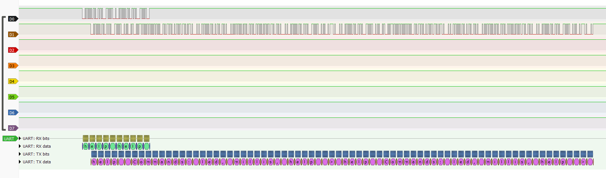
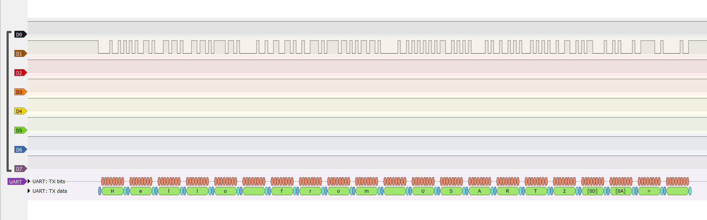

# Bare-metal UART command shell on STM32F411

Bare-metal C on an STM32 Nucleo-F411RE board. No HAL and no generated setup code: each peripheral is configured by writing its registers directly, with addresses and bit positions taken from ST's manuals.

[LOG.md](LOG.md) is the learning record behind this repo.

The project is a UART command shell on USART2, built from the registers up. It takes commands typed in a PC terminal. `led` toggles LD2, `help` lists the commands, and `millis` prints the milliseconds since startup. An interrupt handler moves each received byte into a ring buffer, so commands sent back to back aren't lost while the shell replies.

Both wires of USART2 on a logic analyzer, decoded by PulseView. The PC sends `help` twice in one write (top). The second command arrives while the board is still sending its first reply (bottom), and the shell runs both.

## Demo

https://github.com/user-attachments/assets/96a4cb40-5133-4d7f-9b38-600d61514c75

## Captures

The shell's frames, captured with the logic analyzer at 115200 baud, 8N1. The PulseView sessions and all four pictures are in [captures/](captures), and the 2026-11-10 entry in [LOG.md](LOG.md) has the details.

- **A frame read by hand.** The banner's first frame measured low for 4 bit times, then 1 high, 2 low, 1 high, 1 low, and the stop bit. Least significant bit first, that is 0x48, `H`. The decoder agrees, and shows the banner's 21 frames.
- **Nothing lost.** In the two-command picture above, RX carries 10 frames and TX 74: each command's 4 echoed letters and its 33-byte reply.
- **Bit time.** 370 bits on TX measured 3,217.5 µs, against 3,211.8 µs at exactly 115200 baud. Of the 5.7 µs, 2.6 come from rounding the baud rate divider to 139, and 3.1 from the internal oscillator running 0.096% slow. A different measurement on 2026-11-02 put it 0.095% slow.
- **The PC's bytes arrive back to back.** 9 frames on RX measured 780.0 µs, against 781.25 µs with no gaps.

## Hardware

- NUCLEO-F411RE: STM32F411RE microcontroller (Arm Cortex-M4), with an on-board ST-LINK for flashing and debugging
- HiLetgo 24 MHz, 8-channel USB logic analyzer, read with sigrok PulseView. For USART2 it connects at CN3, the ST-LINK's TX and RX header; on my board, CN10 pins 35 and 37 carried no signal (see LOG)

## Toolchain

- STM32CubeIDE for Visual Studio Code: CMake build with arm-none-eabi-gcc (GNU Tools for STM32 14.3.1+st.2)
- Empty project: ST's startup file and linker script, no HAL
- Debugging: ST's peripheral register view, the Memory Inspector for reading raw memory at an address, and the Watch panel for variables
- Serial terminal: `screen` in WSL, with the board attached to WSL

## Status

| Step | State |
| --- | --- |
| Const placement experiment | Done, measured in the linker's memory report |
| Turn on GPIOA's clock | Done, verified by the blink |
| Set PA5 to output | Done, verified by the blink |
| Toggle LD2 (PA5) | Done |
| Busy-wait delay | Done: 51 to 52 blinks per minute (Debug build, 60-second video) |
| Remove volatile in an optimized build | Done: without `volatile`, -O2 shrank the delay or deleted it (see LOG) |
| Read MODER back in the debugger | Done: 0xA8000000 before the setup line, 0xA8000400 after; PA5's field 01 (output) |
| Read GPIOA with its clock off | Done: a debugger read of GPIOA_MODER with GPIOAEN = 0 returned 0xA8000000 |
| Check the Memory Inspector against known values | Done: RCC_CR read 0x00006983 at `main` and RCC_AHB1ENR 0x00000001 after the enable; RCC_PLLCFGR and GPIOA's first four registers read their reset values |
| Byte order in memory | Done: GPIOA_MODER (0xA8000400) sits in memory as 00 04 00 a8, lowest address first, so the byte holding bits 7:0 is at the lowest address (little-endian) |
| SysTick delay | Done: a 1 ms SysTick tick drives `delay_ms()`; 60 blinks per minute in the Debug build and with `#pragma GCC optimize("O2")` |
| Remove volatile from the tick counter at -O2 | Done: LD2 stuck on while `elapsed_ms` kept climbing (see LOG) |
| Where variables live | Done: in the Debug build, `&elapsed_ms` read 0x200001B8 (`.bss`, near the bottom of RAM) and `&start` read 0x2001FFEC (stack, 20 bytes below the top) |
| Measure LD2 with a logic analyzer | Done: high time 499.98 to 500.68 ms against 500 ms, over two 10-second captures at 100 kHz; the internal oscillator (HSI) ran about 0.1% off (see LOG) |
| USART2's clock and pins | Done: RCC_APB1ENR 0x00020000, GPIOA_MODER 0xA80004A0, and GPIOA_AFRL 0x00007700 (PA2 and PA3 on AF7). The first build enabled the clock in the wrong register, and the reading caught it (see LOG) |
| USART2 at 115200 baud, 8N1 | Done: BRR 0x8B (139 cycles per bit, 0.08% slow) and CR1 0x200C; "Hello from USART2" reached the PC's terminal through the ST-LINK; with the terminal set to 9600, it arrived as garbage |
| Echo | Done: typed bytes come back. A byte typed while the debugger had the CPU halted came back after Continue |
| Line buffer, `led`, and `help` | Done: `led` toggles LD2 and reports its new state, and `help` lists the commands. A line holds 31 letters plus its `\0`, and extra letters are dropped (see LOG) |
| `millis` | Done: prints the milliseconds since startup in decimal, without `printf`. Two readings 10.34 s apart by a phone stopwatch differed by 10,326 ms (see LOG) |
| Overrun on the polled shell | Done: with two commands sent in one write, only the first letter of the second reached the shell. Its other 4 bytes arrived while the 33-byte `help` reply went out and were lost (see LOG) |
| Receive by interrupt into a ring buffer | Done. The same two-command write ran both commands, and the drop and overrun counters read 0. With the CPU halted, typed bytes overran, and the handler counted the overrun on Continue (see LOG) |
| Capture the shell's frames | Done: the banner's first frame read by hand as 0x48, `H`, then 21 frames decoded. In the two-command write, 10 frames on RX and 74 on TX. 370 bits measured 3,217.5 µs, which splits into the divider's rounding and an oscillator 0.096% slow (see LOG) |
| UART command shell | Done: `led`, `help`, and `millis`, received by interrupt into a ring buffer, with logic analyzer captures of its frames |

## Build and run

Open the folder in VS Code with the STM32CubeIDE for Visual Studio Code extension. Start the "STM32Cube: Launch ST-Link GDB Server" debug configuration: it builds, flashes the board, and stops at `main`.

Open the ST-LINK's virtual COM port in a serial terminal at 115200 baud, 8 data bits, no parity, 1 stop bit. On WSL, with the board attached, the port is `/dev/ttyACM0`: `screen /dev/ttyACM0 115200` (Ctrl-A, then K, closes it). On Windows, PuTTY on the board's COM port works too.

Press Continue. The terminal shows "Hello from USART2" and a `>` prompt. Type `help` and press Enter to list the commands.

## References

- RM0383: STM32F411xC/E reference manual (registers and memory map)
- UM1724: STM32 Nucleo-64 boards user manual (board wiring)
- PM0214: STM32 Cortex-M4 programming manual (SysTick, the NVIC, exceptions, and the vector table)

All three are free PDFs from st.com.
